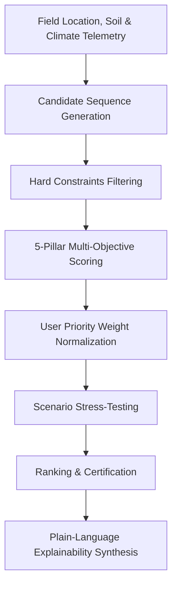

# FieldShift: Agronomic Methodology & Scoring Formulation

> **2026 NASA Space Apps Challenge:** "Field Shift: Adapting Farms with NASA Data"  
> **Team:** Moon Chanter  
> **Module Path:** `/src/engine`  

---

## 1. Core Philosophy: Transparent, Explainable Decision Support

Modern smallholder farming requires high trust. A farmer will not risk their season's livelihood on a black-box machine learning output. Therefore, FieldShift's recommendation engine is engineered as a **pure TypeScript, rule-based decision support system** where every score, recommendation, and risk warning is 100% auditable and traces back to agronomic literature and NASA telemetry.

---

## 2. Recommendation Engine Pipeline

### Stage 1: Candidate Permutation & Hard Constraints

A 3-season rotation sequence $(S_1 \to S_2 \to S_3)$ corresponds to the Philippine tropical monsoon calendar:
- **Season 1 ($S_1$):** Wet Season / Habagat (June – October)
- **Season 2 ($S_2$):** Cool Dry Season / Amihan (November – February)
- **Season 3 ($S_3$):** Hot Dry Season / Catch Window (March – May)

#### Hard Agronomic Constraints:
1. **Planting Window Match:** Crop must possess the designated season tag (`crop.plantingWindows.includes(season)`).
2. **Soil & Drainage Compatibility:** Crop soil texture and drainage tolerance must accommodate the field profile.
3. **Monoculture Ban:** Identical crop cannot occupy back-to-back seasons ($c_t \ne c_{t-1}$).
4. **Strict Solanaceae Ban:** Consecutive planting of Solanaceae (Tomato $\to$ Eggplant) is strictly banned to prevent the devastating build-up of *Ralstonia solanacearum* (bacterial wilt) and root-knot nematodes.
5. **Grass Monoculture Penalty:** Grass $\to$ Grass $\to$ Grass without a legume or broadleaf break is disallowed.
6. **Farmer Exclusions:** Excludes any crop toggled off by the user.

---

## 3. Multi-Pillar Scoring Model (0–100 per pillar)

Each candidate rotation sequence is evaluated across 5 agronomic and economic pillars:

### A. Soil Health ($S_{\text{soil}}$)
- **Base Score:** 30 pts.
- **Nitrogen Fixation:** $+25$ pts for 1 legume (e.g., Mungbean, Peanut, Cowpea); $+35$ pts for $\ge 2$ legumes. Fixes 35–80 kg biological N/ha.
- **Root Stratification:** $+20$ pts if sequence combines shallow fibrous rooters (Rice) with deep taproots (Cassava, Peanut, Sunn hemp). Penetrates plow pan and aerates soil.
- **Clay Soil Deep Root Bonus:** $+8$ pts if field is heavy clay and contains a deep-rooting aerator.
- **Organic Matter Restoration:** $+10$ pts if field has low SOC and includes high residue or legume cover.
- **Stover / Biomass Contribution:** $+8$ pts per high-residue crop (Corn stover, Legume biomass).
- **Botanical Family Diversity:** $+15$ pts for 3 distinct families; $+8$ pts for 2 families.

### B. Water Resilience ($S_{\text{water}}$)
- **Base Score:** 40 pts.
- **Monsoon Adaptation ($S_1$):** If NASA POWER wet season rainfall $> 1000\text{ mm}$, $+25$ pts for high flood tolerance (Rice); $-15$ pts for waterlog-sensitive crops.
- **Cool Dry Transition ($S_2$):** $+15$ pts for low or medium water demand.
- **Hot Dry Drought Defense ($S_3$):** $+25$ pts for high drought tolerance; $-20$ pts for drought-sensitive crops; $+15$ pts for low water demand.

### C. Climate Shock Buffer ($S_{\text{climate}}$)
- **Base Score:** 40 pts.
- **Extreme Heat Tolerance:** If NASA POWER records peak $T_{\max} \ge 34.0^\circ\text{C}$ in Hot Dry months, $+25$ pts for high heat-tolerant crops (Mungbean, Cowpea, Sweet Potato, Cassava); $-20$ pts for heat-sensitive crops.
- **Excess Rain Typhoon Protection:** $+20$ pts if peak wet season risk is high and $S_1$ has high flood tolerance.
- **Dry Spell Shield:** $+8$ pts per drought-hardy crop under high dry-spell risk.

### D. Economic Viability ($S_{\text{econ}}$)
- **Base Score:** 45 pts.
- **Market Value Tier:** $+14$ pts per high market tier crop (Mungbean, Peanut, Eggplant, Tomato, Rice).
- **Input Cost Burden:** $-8$ pts per high-input crop; $+8$ pts per low-input crop.
- **Staple Food Security:** $+10$ pts for presence of staple grain (Rice or Corn).

### E. Labor Feasibility ($S_{\text{labor}}$)
- **Base Score:** 50 pts.
- **Workload Smoothing:** $-12$ pts per high-labor crop; $+14$ pts per low-labor crop. Prevents simultaneous labor bottlenecks.

---

## 4. Priority Weighting & Overall Composite Score

The farmer's subjective priorities are captured through 6 sliders ($W_{\text{soil}}, W_{\text{water}}, W_{\text{climate}}, W_{\text{income}}, W_{\text{cost}}, W_{\text{labor}}$):

$$\text{Composite Score} = \frac{W_{\text{soil}} S_{\text{soil}} + W_{\text{water}} S_{\text{water}} + W_{\text{climate}} S_{\text{climate}} + (W_{\text{income}} + W_{\text{cost}}) S_{\text{econ}} + W_{\text{labor}} S_{\text{labor}}}{\sum W_k}$$

The weights normalize dynamically so moving any slider visibly and immediately shifts the plan rankings.

---

## 5. Scenario Stress-Testing Formulation

Every generated plan is tested across 5 climate conditions:

1. **Baseline:** Standard NASA POWER 10-year climatology.
2. **Hotter ($+1.5^\circ\text{C}$):** Simulates Paris Agreement warming boundary; penalizes low heat tolerance ($-9$ pts/crop).
3. **Drier ($-15\%$ seasonal rainfall):** Simulates strong El Niño; penalizes high water demand ($-8$ pts) and drought-intolerant crops ($-10$ pts).
4. **Hotter + Drier Compound Shock:** Simultaneous compound thermal and hydrological stress.
5. **Wetter ($+15\%$ intense rainfall):** Simulates intense La Niña monsoon and repeated typhoon depressions; penalizes non-flood tolerant crops in $S_1$ ($-16$ pts).

### Robustness Classification:
- **Climate-Robust:** Maximum score degradation $\le 12$ pts AND lowest scenario score $\ge 68$.
- **Moderate Resilience:** Maximum score degradation $\le 22$ pts.
- **Vulnerable to Shock:** Maximum score degradation $> 22$ pts OR lowest scenario score $< 52$.

---

## 6. Traceable Explainability Engine

Each recommendation synthesizes:
1. **Rule Tags:** Formatted with standardized IDs (e.g., `[AGRO-RULE-01-NFIX]`, `[AGRO-RULE-02-ROOT-STRAT]`, `[AGRO-RULE-03-HYDRO-ALIGN]`).
2. **Telemetry Citations:** Embeds exact measured values (e.g., *NASA POWER 10-year precipitation of 65mm in March–May*, *Soil Organic Carbon of 1.42%*).
3. **Farmer-Actionable Mitigations:** Concrete agronomic actions for every identified operational risk (e.g., *apply rice straw mulch to reduce evaporation during late April flowering*).
