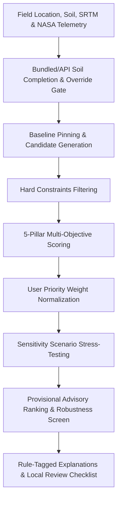

# FieldShift: Agronomic Methodology & Scoring Formulation

> **2026 NASA Space Apps Challenge:** "Field Shift: Adapting Farms with NASA Data"  
> **Team:** Moon Chanter  
> **Module Path:** `/src/engine`  

---

## 1. Core Philosophy: Transparent, Explainable Decision Support

Modern smallholder farming requires high trust. A farmer will not risk their season's livelihood on a black-box machine learning output. Therefore, FieldShift's recommendation engine is engineered as a **pure TypeScript, rule-based decision support system** where every score, recommendation, and risk warning is 100% auditable and traces back to agronomic literature and NASA telemetry.

---

## 2. Recommendation Engine Pipeline

### Stage 0: Soil Input Completion & Provenance Gate (`hasRequiredSoilInputs`)

Before ranking runs (`src/engine/soilInputs.ts`), FieldShift requires complete field soil parameters (`texture`, `drainage`, `ph`, `organicMatter`):
- **Masked 250 m SoilGrids Pixel Recovery (`src/services/bundledSoilGrids.ts`):** Pilot default coordinates in `src/data/pilotLocations.ts` target verified complete cropland pixels (`docs/COORDINATE_AUDIT.md`), while any queried pixel inside packaged coverage that lands on a `NoData` cell (urban/built-up/water, such as town-hall cell #41) is recovered deterministically by `resolveBundledSoil` to the nearest complete 250 m agricultural cell (e.g., Muñoz cell #32, Malaybalay cell #42, ~250 m away) and discloses the exact requested cell, substituted cell, and offset distance in `SoilModelDetails`.
- **Transparent Derived Properties (`src/services/soilDerivation.ts`):** When SoilGrids supplies native `soc` (dg/kg) and clay/sand/silt texture without laboratory organic-matter or percolation measurements, FieldShift derives preliminary values tagged `tier: 'synthetic'`, `isSynthetic: true`, `needsReview: true`:
  - **Organic Matter (`deriveOrganicMatterFromSoc`):** Van Bemmelen approximation $\text{OM\%} = (\text{soc} / 100) \times 1.724$ ($\text{Low} < 1.0\%$, $\text{Medium} = 1.0\text{–}2.5\%$, $\text{High} > 2.5\%$).
  - **Preliminary Drainage (`derivePreliminaryDrainage`):** Classified from topsoil texture / clay / sand fractions and refined dynamically when real SRTM `slopePct` arrives (`poor` $\to$ `moderate` when `slopePct > 8%`; `moderate` $\to$ `well` when `slopePct > 15%`).
- **One-Click DA-BSWM Municipal Baseline & Farmer Override (`src/services/soilGrids.ts`, `src/store/useAppStore.ts`):** Farmers and technicians can switch anytime between SoilGrids telemetry and the labeled DA-BSWM municipal soil reference (`getMunicipalAgriculturalBaseline`), or enter 1-tap parcel overrides (`setSoilOverride`), with complete undo (`restoreSoilTelemetry` / `resetSoilOverride`).

### Stage 1: Strategy 1 Baseline Pinning, Candidate Permutation & Hard Constraints

A 3-season rotation sequence $(S_1 \to S_2 \to S_3)$ corresponds to the Philippine tropical monsoon calendar:
- **Season 1 ($S_1$):** Wet Season / Habagat (June – October)
- **Season 2 ($S_2$):** Cool Dry Season / Amihan (November – February)
- **Season 3 ($S_3$):** Hot Dry Season / Catch Window (March – May)

To make diversification trade-offs concrete (`src/engine/candidateGenerator.ts`), the engine pins **Strategy 1** (the common farmer continuous monocrop + bare-fallow baseline, marked `isBaseline: true` and exempted from agronomic host-conflict hard bans purely for side-by-side comparison):
- **Lowlands:** *Existing Baseline: Continuous Double Rice $\to$ Bare Fallow* (`rice → rice → fallow`)
- **Sloping Uplands (`slopePct > 15%` or non-model acid upland `ph < 5.5 && drainage !== 'poor'`):** *Existing Baseline: Continuous Upland Corn $\to$ Bare Fallow* (`corn → corn → fallow`)

Alongside pinned Strategy 1, FieldShift includes canonical adaptive templates (such as **Adaptive Relay: Wet Rice $\to$ Pag-asa Mungbean $\to$ Dry Yellow Corn**, **Commercial Diversification: Wet Rice $\to$ Bulb Onion $\to$ Pre-Rice Mungbean**, and **Upland Soil Armor: Corn $\to$ Mungbean $\to$ Sweet Potato (Kamote)**) plus all generated candidate sequences passing hard constraints:

#### Hard Agronomic Constraints:
1. **Planting Window Match:** Crop must possess the designated season tag (`crop.plantingWindows.includes(season)`).
2. **Soil & Drainage Compatibility:** Crop soil texture and drainage tolerance must accommodate the field profile.
3. **Monoculture Ban (Non-Baseline Candidates):** Identical crops cannot occupy back-to-back seasons ($c_t \ne c_{t-1}$).
4. **Strict Solanaceae Ban:** Consecutive planting of Solanaceae (Tomato $\to$ Eggplant) is strictly excluded to prevent bacterial wilt (*Ralstonia solanacearum*) and root-knot nematode escalation.
5. **Grass Monoculture Guardrail:** Grass $\to$ Grass $\to$ Grass without a legume or broadleaf break is disallowed for diversification candidates.
6. **Farmer Exclusions:** Excludes any crop toggled off by the user.

---

## 3. Multi-Pillar Scoring Model (0–100 per pillar)

Each candidate rotation sequence is evaluated across 5 agronomic and economic pillars (`src/engine/scoring.ts`):

### A. Soil Health ($S_{\text{soil}}$)
- **Base Score:** 30 pts.
- **Nitrogen Fixation (`[AGRO-RULE-01-NFIX]`):** $+25$ pts for 1 legume (e.g., Pag-asa Mungbean, Peanut); $+35$ pts for $\ge 2$ legumes (biological N fixation + synthetic N savings).
- **Root Stratification (`[AGRO-RULE-02-ROOT-STRAT]`):** $+20$ pts across 3 distinct rooting depths (shallow fibrous roots paired with deep taproots); $+12$ pts for 2 depths.
- **Plow-Pan & Model-Support Boundaries (`[AGRO-RULE-05-MODEL-SUPPORT]`):** $+8$ pts when heavy clay or verified non-model compacted soil (`bulkDensityGcm3 > 1.4`) includes deep/medium roots; $-8$ pts on continuous double-rice compaction. Imported SoilGrids topsoil density (`0–15 cm`) and pixel pH alone do not auto-diagnose a subsoil plow pan or sloping upland without parcel/terrain evidence.
- **Organic Matter & Biomass (`[AGRO-RULE-05-BIOMASS-MULCH]`):** $+10$ pts when field OM is `low` and rotation includes legumes or high-residue crops; $+8$ pts per high-residue biomass crop.
- **Botanical Family Diversity & Pest Breaks (`[AGRO-RULE-03-PESTBREAK]`):** $+15$ pts for 3 distinct botanical families, $+8$ pts for 2, $-12$ pts for single family; plus host-carryover penalties: Corn $\to$ Corn ($-22$ pts, Fall Armyworm), Solanaceae $\to$ Solanaceae ($-28$ pts, Bacterial Wilt), Onion $\to$ Onion ($-24$ pts, Purple Blotch), and Rice $\to$ Rice ($-10$ pts).
- **Upland Canopy Cover & Acid Soil (`[AGRO-RULE-04-EROSION-ACID]`):** On verified sloping uplands ($>15\%$ slope), bare fallow incurs $-24$ pts (RUSLE soil exposure) while legume/cover cropping adds $+14$ pts; bare fallow on acid/high P-fixation soils incurs $-8$ pts.

### B. Water Resilience ($S_{\text{water}}$)
- **Base Score:** 40 pts.
- **Monsoon Adaptation ($S_1$):** If NASA POWER wet season rainfall $> 1000\text{ mm}$, $+25$ pts for high flood tolerance (Rice); $+12$ pts medium; $-15$ pts for waterlog-sensitive crops.
- **Cool Dry Transition ($S_2$):** $-18$ pts for dry-season paddy rice; $+15$ pts for low/medium water demand; $+8$ pts extra (`[AGRO-RULE-01-NFIX]`) when short-cycle Pag-asa Mungbean saves water vs. paddy rice.
- **Hot Dry Drought Defense ($S_3$):** $+25$ pts high drought tolerance ($+10$ medium, $-20$ low); $+15$ pts low water demand ($-15$ high); $-12$ pts for sloping upland fallow runoff.

### C. Climate Shock Buffer ($S_{\text{climate}}$)
- **Base Score:** 45 pts.
- **Dry-Season Rice Heat Sterility (`[AGRO-RULE-02-HEAT35]`):** When dry-season rice overlaps Hot Dry $T_{\max} > 35.0^\circ\text{C}$ (April 10 – May 30), applies $-\text{round}(28 + 10 \cdot (T_{\max} - 35.0))$ pts for spikelet sterility risk. Otherwise, if Hot Dry $T_{\max} \ge 34.0^\circ\text{C}$, awards $+22$ pts for high heat tolerance ($+10$ medium, $-20$ low).
- **Pest Resilience (`[AGRO-RULE-03-PESTBREAK]`):** $+6$ pts for 3-family break; $-10$ pts for host conflict.
- **Monsoon & Dry-Spell Risk:** $+20$ pts for high wet flood tolerance under high excess-water risk; $+8$ pts per high-drought-tolerance crop under high dry-spell risk.

### D. Economic Viability ($S_{\text{econ}}$)
- **Base Score:** 45 pts.
- **Market Tier, Input Burden & Fallow:** $+14$ pts per high-market crop; $+8$ pts per low-input / $-8$ pts per high-input crop; $-12$ pts for lost harvest on bare fallow.
- **Agronomic Cost & Yield Adjustments:** $+8$ pts legume N savings ($+4$ pts Mungbean, `[AGRO-RULE-01-NFIX]`); $-\text{round}(14 + 8 \cdot (T_{\max} - 35.0))$ revenue loss on $>35^\circ\text{C}$ dry-season rice (`[AGRO-RULE-02-HEAT35]`); $-10$ pts pest cost penalty (`[AGRO-RULE-03-PESTBREAK]`); $+10$ pts staple food security (Rice or Corn).

### E. Labor Feasibility ($S_{\text{labor}}$)
- **Base Score:** 50 pts.
- **Workload Smoothing:** $-12$ pts per high-labor crop; $+14$ pts per low-labor crop. Prevents simultaneous labor bottlenecks.

---

## 4. Priority Weighting & Overall Composite Score

The farmer's subjective priorities are captured through 6 sliders ($W_{\text{soil}}, W_{\text{water}}, W_{\text{climate}}, W_{\text{income}}, W_{\text{cost}}, W_{\text{labor}}$):

$$\text{Composite Score} = \frac{W_{\text{soil}} S_{\text{soil}} + W_{\text{water}} S_{\text{water}} + W_{\text{climate}} S_{\text{climate}} + (W_{\text{income}} + W_{\text{cost}}) S_{\text{econ}} + W_{\text{labor}} S_{\text{labor}}}{\sum W_k}$$

The weights normalize dynamically so moving any slider visibly and immediately shifts the plan rankings.

---

## 5. Scenario Stress-Testing Formulation

Every generated plan is tested across 5 climate conditions:

1. **Baseline:** Standard NASA POWER 10-year climatology.
2. **Hotter ($+1.5^\circ\text{C}$):** Simulates Paris Agreement warming boundary; penalizes low heat tolerance ($-9$ pts/crop).
3. **Drier ($-15\%$ seasonal rainfall):** Simulates strong El Niño; penalizes high water demand ($-8$ pts) and drought-intolerant crops ($-10$ pts).
4. **Hotter + Drier Compound Shock:** Simultaneous compound thermal and hydrological stress.
5. **Wetter ($+15\%$ intense rainfall):** Simulates intense La Niña monsoon and repeated typhoon depressions; penalizes non-flood tolerant crops in $S_1$ ($-16$ pts).

### Robustness Classification:
- **Climate-Robust:** Maximum score degradation $\le 12$ pts AND lowest scenario score $\ge 68$.
- **Moderate Resilience:** Maximum score degradation $\le 22$ pts.
- **Vulnerable to Shock:** Maximum score degradation $> 22$ pts OR lowest scenario score $< 52$.

---

## 6. Traceable Explainability & Local Review Checklist (`src/engine/explainer.ts`)

Every plan stays framed as provisional advisory decision support and synthesizes:
1. **Standardized Rule Tags:** `[AGRO-RULE-01-NFIX]` (biological N fixation & water savings), `[AGRO-RULE-02-HEAT35]` (`> 35°C` April 10 – May 30 dry-season rice sterility), `[AGRO-RULE-02-ROOT-STRAT]` (root stratification), `[AGRO-RULE-03-PESTBREAK]` (`Corn → Corn` Fall Armyworm, `Solanaceae → Solanaceae` Bacterial Wilt, `Onion → Onion` Purple Blotch, `Rice → Rice` pest carryover), `[AGRO-RULE-03-HYDRO-ALIGN]` (monsoon hydrology fit), `[AGRO-RULE-04-EROSION-ACID]` (`slopePct > 15%` or `pH < 5.5` canopy cover / lime & plow-pan inspection), `[AGRO-RULE-05-BIOMASS-MULCH]` (organic residue retention), and `[AGRO-RULE-05-MODEL-SUPPORT]` (SoilGrids topsoil prediction / model pH boundaries).
2. **Telemetry & Provenance Citations:** Embeds the specific NASA POWER rainfall/temperature readings and soil values alongside `source | variable | spatial resolution | date range` and `needsReview` flags.
3. **Actionable Field Mitigations & `generateLocalReviewChecklist`:** Pairs operational warnings with farmer actions (such as rice-straw mulching or pre-rice mungbean inoculation) and surfaces parcel-level verification prompts (municipal baseline differences, synthetic or cached inputs, grid pixel scale, canal turnouts, plow-pan compaction, and local buyer prices).

## Land NDVI profile and annual trend

Municipal land fixtures supply twelve January–December NDVI values. The initial profiles are synthetic demonstrations with `needsReview` metadata and no claimed satellite observation period. The monthly profile describes seasonal variation. Annual trend uses ordinary least squares on comparable annual mean observations, with calendar year as the independent variable and units of NDVI change per year. Missing observations, a single year, or repeated years produce compatibility zero with an explicit unavailable reason. The UI must display insufficient data for this state. The initial fixtures contain no annual observations.

## Preliminary lowland screen [LAND-RULE-FLOOD]

The proposed screen flags elevation below 30 meters together with slope at or below 3 percent. Both named thresholds carry `needsReview` and require local drainage/flood validation. With the initial illustrative profiles, Pototan is flagged, while Muñoz, Ilagan, and Malaybalay are unflagged. Elevation exactly 30 meters is outside the screen; slope exactly 3 percent is included. Terrain alone cannot establish river, storm, drainage, or infrastructure exposure. A technician should consult local flood information before making a field decision.

## Possible bare-field months [LAND-RULE-BARE]

A month is flagged when its NDVI is strictly below `BARE_FIELD_NDVI_THRESHOLD = 0.25` and it is within `FALLOW_WINDOW_MONTHS = [3, 4, 5, 6]`. Both assumptions have `needsReview` metadata for regional crop-calendar and imagery validation. Output months are unique, sorted, and one-based. Low NDVI can reflect several surface and observation conditions, so each flag requires local verification.

## Illustrative annual erosion [LAND-RULE-RUSLE]

The calculation uses `A = R × K × LS × C × P`. R represents rainfall erosivity, K soil erodibility, LS slope length/steepness, C cover/management, and P support practices. This factor structure and its sheet/rill process scope follow USDA guidance. [USDA NRCS user guide](https://www.nrcs.usda.gov/sites/default/files/2022-10/RUSLE2_NRCS_Guide_April_2017_0.pdf)

Fixtures explicitly use SI units for R (`MJ mm ha-1 h-1 yr-1`) and K (`t ha h ha-1 MJ-1 mm-1`), with dimensionless LS, C, and P, yielding metric tonnes per hectare per year. The estimate is rounded to one decimal. Negative/nonfinite factors, incompatible unit declarations, and numeric overflow are rejected.

`coverFactorFromNdvi` uses the illustrative mapping `C = (1 − max(0, mean annual NDVI))²`, bounded between zero and one for NDVI in [-1, 1]. Increasing NDVI produces an equal or smaller C. The exponent 2 and this entire mapping carry `needsReview`; they require calibration with local management and erosion observations. This application implements a simplified factor calculation. The full NRCS model includes additional process and management treatment. The result addresses rainfall-driven sheet/rill processes. Municipal synthetic inputs, unresolved soil factors, gullies, channel erosion, and mass movement limit its application to field decisions. [USDA NRCS model overview](https://www.nrcs.usda.gov/resources/tech-tools/water-erosion-rusle2)

### Land assumptions requiring verification

- Existing preset elevations, new slope values, all monthly NDVI values, and R/K/LS/P values in the demonstration fixtures.
- The 30-meter and 3-percent terrain-screen thresholds.
- The NDVI threshold of 0.25 and the March–June fallow window.
- The NDVI-to-C mapping and its exponent of 2.
- Product resolutions, observation periods, and comparable annual NDVI observations, which remain unavailable in the synthetic fixtures.

Every derived land summary propagates the fixture's sample/synthetic status and review notes. No severity bands are assigned to the erosion estimate.
